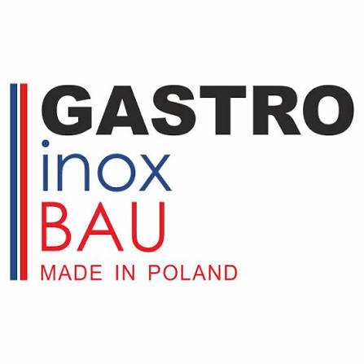

# GASTRO inox BAU – Generator Zabudowy Przyczep Gastronomicznych & Food Trucków



[](LICENSE)
[](https://react.dev/)
[](https://threejs.org/)
[](https://vitejs.dev/)
[](https://tailwindcss.com/)

> **Profesjonalny konfigurator 3D i 2D CAD zabudowy przyczep gastronomicznych i food trucków.**  
> Zgodny z polskimi normami **Sanepid / HACCP / GHP**, przepisami drogowymi (DMC / kategorie prawa jazdy) oraz dyrektywami maszynowymi.

---

## 🌐 Demo na żywo

👉 **[Uruchom aplikację online](https://ais-pre-k6cdiin52ztxvne5ymouir-97378884096.europe-west3.run.app)**

---

## ✨ Główne funkcje systemu

### 1. Interaktywny model 3D (Three.js)
- Podwozia AL-KO / Knott (1- lub 2-osiowe tandem z dyszlem trójkątnym i kołem manewrowym).
- Otwierana klapa sprzedażowa ze wspomaganiem siłownikami gazowymi i tablicą menu.
- Tryby przekrojów: pełna przyczepa, zdjęcie dachu (*Roof-Off*) oraz transparentne ściany (*X-Ray*).
- Zmiana kolorystyki poszycia z palety lakierów RAL.
- Fabryczny emblemat w chromowanej ramie **GASTRO inox BAU (Made in Poland)**.
- 4 perspektywy kamery: Izometria, Klient (okno wydawcze), Wnętrze technologiczne, Rzut z góry.

### 2. Rzut architektoniczny 2D (Floor Planner CAD)
- Skalowana siatka milimetrowa/centymetrowa z dokładnym pozycjonowaniem i obrotem modułów o 90°.
- **Wizualny wskaźnik ścieżki sanitarnej (Dirty-to-Clean)**: wektory przepływu od dostaw surowców przez zmywalnię, obróbkę termiczną, składanie dań po wydawkę.
- **Wykrywanie kolizji HACCP**: automatyczny alert i oznaczenie zakażenia krzyżowego w przypadku umieszczenia zlewu w linii lady wydawczej klienta.

### 3. Eksport 3D do formatów STL & GLTF / GLB
- **Format STL (`.stl`)**: gotowy do pocięcia w slicerach 3D (**Bambu Studio, PrusaSlicer, Cura**) do wydruku makiety fizycznej w skali 1:50 lub 1:25.
- **Format GLTF / GLB (`.glb`)**: zawiera geometrię i materiały dla oprogramowania inżynierskiego CAD (**Autodesk Fusion 360, SolidWorks, Blender, SketchUp**).

### 4. Oficjalne Raporty i Dokumentacja Techniczna PDF
- **Raport Techniczny PDF (Sanepid & Elektryka)**: pełna specyfikacja zamontowanego wyposażenia, bilans mocy (kW), dobór zabezpieczeń B16A–B63A i RCD 30mA, przekrój kabla H07RN-F, lista kontrolna HACCP oraz pola na podpisy i pieczęcie odbiorcze.
- **Kosztorys Handlowy PDF**: zestawienie cenowe podwozia, zabudowy nierdzewnej AISI 304 i urządzeń pod leasing lub kredyt bankowy.

### 5. Inżynieria instalacji & Sanepid
- Automatyczny bilans mocy elektrycznej (230V vs 400V 3-fazy).
- Rekomendacja mocy awaryjnego agregatu prądotwórczego (+25% rezerwy rozruchowej).
- Kontrola dopuszczalnej masy całkowitej (DMC) i rezerwy ładowności.

---

## 🛠️ Uruchomienie lokalne (Development)

Wymagane środowisko: **Node.js 18+** oraz **npm** (lub pnpm / yarn).

```bash
# 1. Sklonuj repozytorium
git clone https://github.com/TWOJA_NAZWA/gastro-inox-bau.git
cd gastro-inox-bau

# 2. Zainstaluj zależności
npm install

# 3. Uruchom serwer deweloperski
npm run dev
```

Aplikacja otworzy się pod adresem: `http://localhost:3000`

---

## 📦 Budowanie wersji produkcyjnej

```bash
npm run build
```

Skompilowane pliki znajdą się w katalogu `dist/` – gotowe do wdrożenia na dowolnym serwerze statycznym (GitHub Pages, Vercel, Netlify, Cloudflare Pages, Apache, Nginx).

---

## 🚀 Publikacja na GitHub Pages

Repozytorium jest skonfigurowane z `base: './'`, dzięki czemu działa od razu na GitHub Pages bez zmian w ścieżkach:

1. Wypchnij kod do gałęzi `main` na GitHubie.
2. Wejdź w **Settings** -> **Pages** w swoim repozytorium.
3. W sekcji **Build and deployment** wybierz źródło:
   - **GitHub Actions** (zalecane, korzysta z dołączonego pliku workflow)
   - lub wybierz gałąź z folderem `dist`.

---

## 📄 Licencja

Projekt udostępniony na licencji **Apache-2.0**. Wykonano dla **GASTRO inox BAU (Made in Poland)**.
